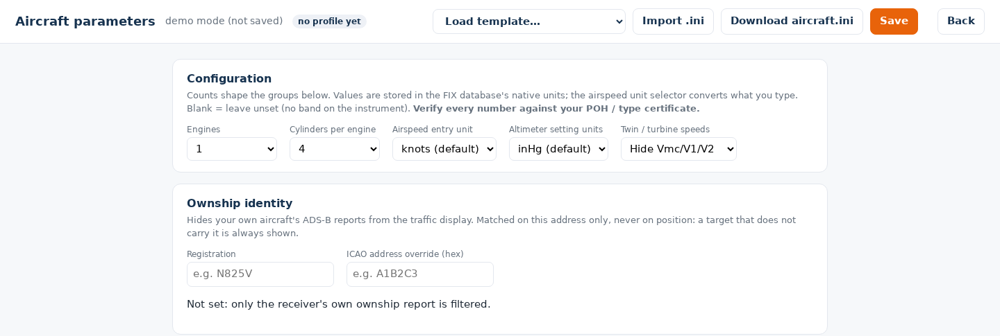
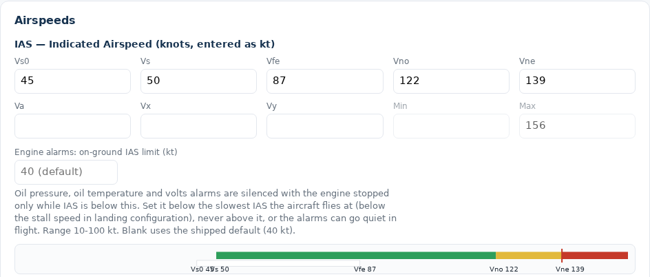
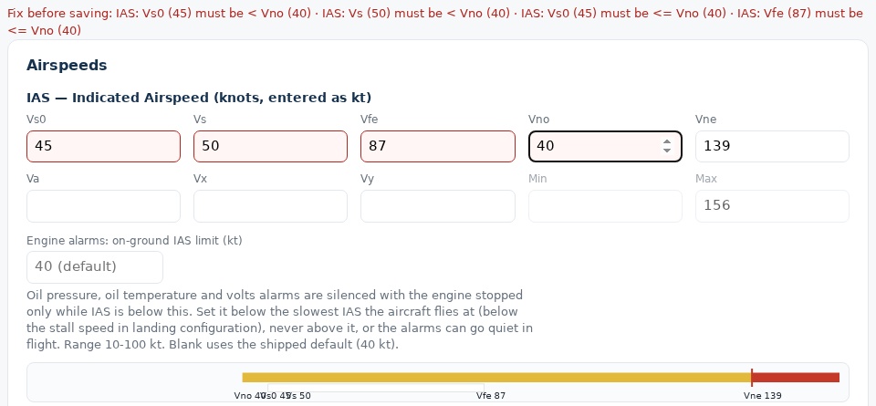

# Aircraft Parameters (CAN-FIX)

Every aircraft has numbers that make its instruments right for that airframe
and engine: the airspeed arcs, the redline, the green and yellow bands on the
engine gauges, the fuel capacities, the electrical limits. The configurator
keeps them as the project's **Aircraft Parameter Profile**: edited as checked
forms, versioned, and turned into an `aircraft.ini` for FIX-Gateway.

Open it from the dashboard with **Aircraft parameters** on a project. The page
is
[`configurator/public/aircraft.html`](https://github.com/billmallard/makerplane-data/blob/dev/configurator/public/aircraft.html);
the server rules are in
[`configurator/src/aircraft_profile.ts`](https://github.com/billmallard/makerplane-data/blob/dev/configurator/src/aircraft_profile.ts).



## Why it is separate from the panel

A V-speed or a gauge band is not a layout choice. It is a value in the
aircraft's FIX database, which the instruments read while running. The same
airspeed tape shows different arcs on a Cub and an RV because the data differs,
not the layout. So:

- the **panel** says where instruments sit and how they look: [[The Configurator]];
- the **profile** holds the airframe and engine numbers they display.

The profile belongs to the project, so every device on the aircraft shares it.

## How the numbers are modelled

In FIX-Gateway each quantity is a **key** (`IAS` for indicated airspeed,
`OILP1` for oil pressure on engine 1) with named **aux** values. V-speeds are aux
values on `IAS`; bands are aux values on each gauge key:

- `IAS` carries `Vs0`, `Vs`, `Vfe`, `Vno`, `Vne`, `Va`, `Vx`, `Vy`, `Min`,
  `Max`, and for twins and turbines `Vmc`, `V1`, `V2`.
- A gauge key such as `OILP1` carries `Min`, `Max`, `lowWarn`, `highWarn`,
  `lowAlarm`, `highAlarm`.

The instruments derive their look from these. The airspeed tape draws white
from Vs0 to Vfe, green from Vs to Vno, yellow from Vno to Vne, and red from
Vne. A gauge colours its bands from its warn and alarm values. A blank value
means no band, and leaving a value blank is always allowed.

Which keys and aux values exist, their units and their sane ranges come from
FIX-Gateway. It generates the parameter schema the form is built from
(`aircraft_params_schema.json`, see [[Configurator Internals]]), so a key added
to FIX-Gateway appears on the form without a change here.

## The page

### Configuration

| Setting | Choices |
|---|---|
| Engines | 1 to 4 |
| Cylinders per engine | 1 to 28 |
| Airspeed entry unit | knots (default), mph, km/h |
| Altimeter setting units | inHg (default), hPa / mb |
| Twin / turbine speeds | Hide or show Vmc, V1 and V2 |

Values are stored in the FIX database's own units. The airspeed entry unit only
converts what you type (1 kt = 1.15078 mph = 1.852 km/h), so a POH in mph can be
entered as printed. The altimeter unit is also sent to the aircraft's displays
(below).

### The groups

The groups come from the schema: **Airspeeds** (`IAS`), **Engine** per engine
(tach, manifold pressure, oil pressure and temperature, fuel flow and
pressure), **Cylinders** per engine (CHT and EGT bands, set once and applied
to every cylinder), **Fuel tanks**, **Electrical** (volts, amps), **Air /
environment** (OAT, CAT) and **AOA**, which is a placeholder until the AOA
integration settles its values. The only engine type today is piston.



The Airspeeds group draws the arcs as you type. It also has the **on-ground IAS
limit**: oil pressure, oil temperature and volts alarms stay quiet with the
engine stopped only while IAS is below it (default 40 kt, range 10 to 100). The
page warns when it is not below Vs0.

### Fuel tanks

A fuel system is a set of tanks and where each one feeds. Each tank has a
label (up to 12 characters), a role (`main`, `aux`, `tip`, `header`,
`transfer`), the fuel sender slot it reads (`FUELQ1` to `FUELQ8`), its
capacity and unusable fuel in gallons, and what it feeds: an engine, or another
tank. Up to 8 tanks
([`configurator/src/fuel_profile.ts`](https://github.com/billmallard/makerplane-data/blob/dev/configurator/src/fuel_profile.ts)).

These block saving: a missing or duplicate label, a duplicate slot, a capacity
of zero, unusable fuel not less than capacity, a slot's `Max` that is not
capacity minus unusable, and a feed to an engine or tank that does not exist, or
to the tank itself. These are warnings that still save: a header tank that
feeds no engine, a tip or transfer tank that feeds no tank, an engine no tank
feeds, a feed loop, and fuel values on a slot no tank uses.

### Ownship identity

**Registration** (up to 10 letters, digits and hyphens) and an optional **ICAO
address override** (six hex digits, not `000000`) name the 24-bit address
whose ADS-B reports the traffic display hides as your own aircraft. The address
is the override if set, otherwise the one derived from a US N-number, otherwise
none, in which case only the receiver's own ownship report is filtered. A
registration starting with `N` must be a valid N-number. Other countries'
registrations do not derive an address; enter the hex from the registration or
the transponder
([`configurator/src/ownship.ts`](https://github.com/billmallard/makerplane-data/blob/dev/configurator/src/ownship.ts)).

The identity is saved with the profile but not yet sent to the aircraft. Until
it is, set the address the card shows as `ownship_address` in FIX-Gateway's
stratux connection.

## Checks

The form marks problems as you type. Errors show as `Fix before saving: …` and
disable **Save** and **Download**; warnings show as `Check: …` and turn **Save**
amber.



Saving checks the whole profile again on the server:

- **Airspeeds:** `Vs0 ≤ Vs < Vno < Vne ≤ Max`, and `Vs0 ≤ Vfe ≤ Vno`.
- **Every other gauge:** `Min ≤ lowAlarm ≤ lowWarn ≤ highWarn ≤ highAlarm ≤ Max`.
- **Units:** the speed unit is `kt`, `mph` or `kph`; the altimeter unit `inHg` or
  `hPa`.
- **Values:** every value is a number.
- **Ownship:** the rules above.

Every pair of filled-in values in a chain is compared, not just neighbours, so a
blank cannot hide an inversion. A pair is strict when any step between them is
strict: Vs0 against Vno is `<` even though Vs0 against Vs is `≤`. A broken rule
reads like `IAS: Vs (60) must be < Vno (55)`. The server refuses a profile that
breaks one with HTTP 422, and the page shows `not saved:` followed by each rule.

## Templates and import

**Load template…** fills the form from a starting point: **Lycoming O-320**,
**Lycoming O-360** and **Continental O-470** engine groups, or a full **Cessna
170B** example. A template is merged over what is already there, after a
confirmation.

**Import .ini** reads an existing FIX-Gateway `init_data` file, lines of the
form `KEY.aux = number`, and reports how many values it took.

## Versions

Each **Save** adds a new version of the profile and makes it active; the
header shows `vN active`. Earlier versions are kept. The page has no list of
versions; the API can list them and make an earlier one active
([[Configurator Internals]]).

## Getting it to the aircraft

**Download aircraft.ini** writes the profile in FIX-Gateway's own `init_data`
format, with a header naming the project, the profile version and the date:

```ini
; aircraft.ini -- generated by the pyEfis configurator (Aircraft parameters)
; project: Example RV-7  profile v3  2026-11-12
; Values are FIX-database native units. VERIFY AGAINST YOUR POH.
; Install: ~/makerplane/fixgw/config/init_data/aircraft.ini, listed LAST
;          under 'initialization files' in default.yaml.

IAS.Vne = 139
...
```

Copy it to `~/makerplane/fixgw/config/init_data/aircraft.ini` on the aircraft
and list it last under `initialization files` in FIX-Gateway's `default.yaml`.
FIX-Gateway loads init files in order, later ones overriding earlier ones, so
the profile overrides the shipped defaults without changing them. Cylinder
bands are written out for every cylinder (`CHT11`, `CHT12`, ...).

One setting reaches the aircraft without the file: the **altimeter setting
unit**. It goes to every paired display of the aircraft with its next
`pyefis-data config-pull`, and every screen starts in it; see
[[Pairing and Config Delivery]]. Sending the rest of the profile the same way
is planned and not built.

## Further reading

- [`docs/canfix_configurator.md`](https://github.com/billmallard/makerplane-data/blob/dev/docs/canfix_configurator.md):
  the design and its decisions.
- [`docs/fuel_provider_model.md`](https://github.com/billmallard/makerplane-data/blob/dev/docs/fuel_provider_model.md):
  the fuel model.
