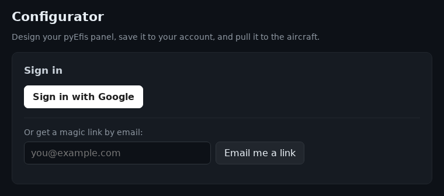
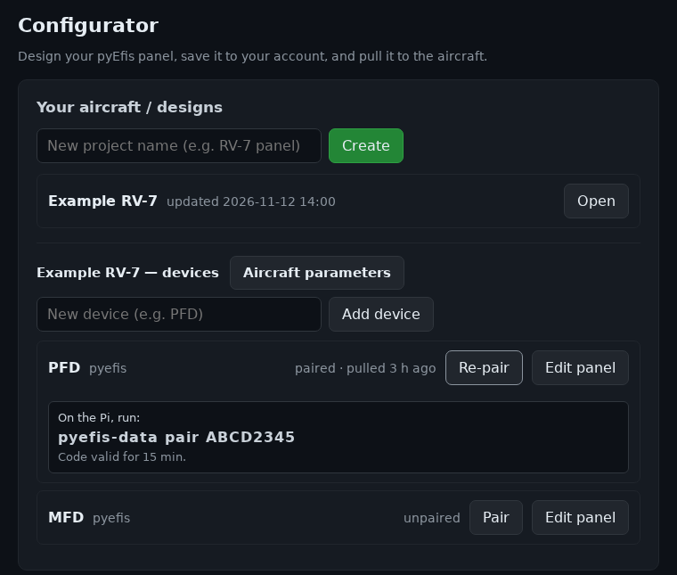
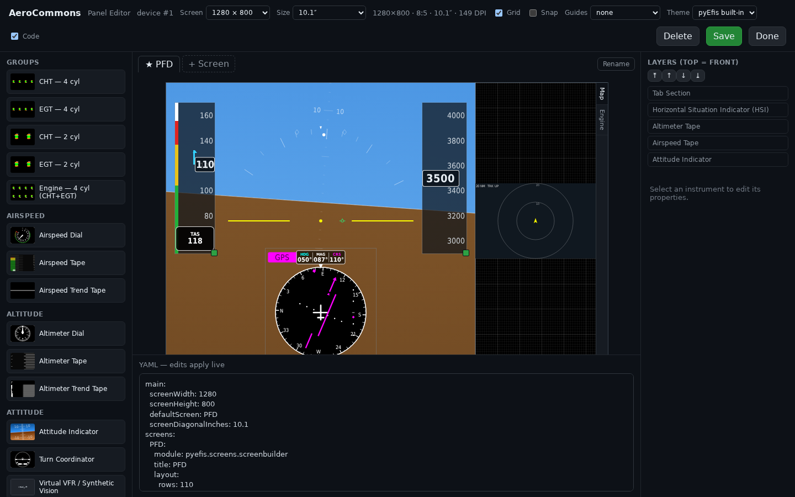
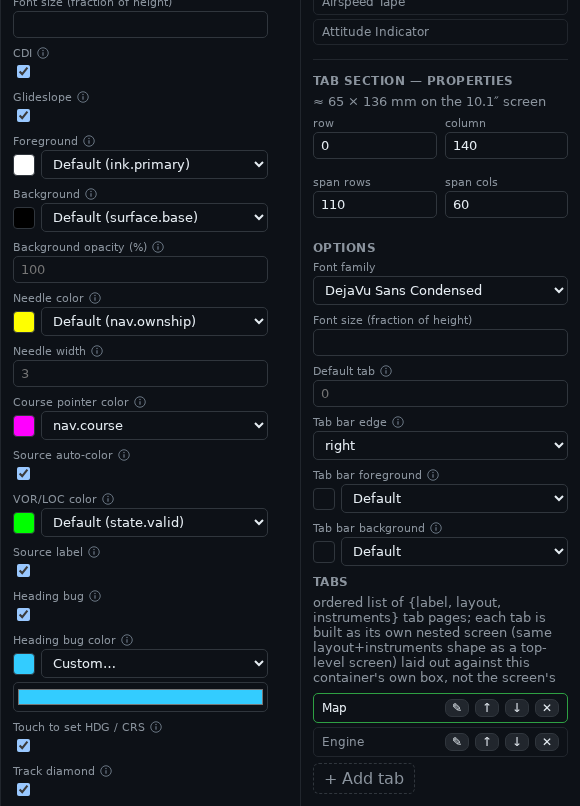

# The Configurator

The configurator, at [pyefis.aerocommons.org](https://pyefis.aerocommons.org),
is where a builder designs the panel and the aircraft parameters, and where a
device gets them from. This page describes the editor in depth, control by
control. For the walkthrough of designing a first panel, start with
[Designing Your Panel](https://github.com/billmallard/pyEfis/wiki/Designing-Your-Panel)
in the pyEfis manual.

| Page | Covers |
|---|---|
| This page | Sign-in, projects and devices, the Panel Editor |
| [[Pairing and Config Delivery]] | Pairing a device, what it downloads, and how `config-pull` installs it |
| [[Configurator Internals]] | How the service runs: the Worker, storage, sign-in, the API, environments |
| [[Aircraft Parameters]] | V-speeds, gauge bands, fuel tanks and the `aircraft.ini` file |

The code is in
[`configurator/`](https://github.com/billmallard/makerplane-data/tree/dev/configurator).

## Signing in

Sign in with Google, or enter an email address and use the link that arrives.
A link works once and expires after 15 minutes. You can see and change only
your own projects and devices.

## Projects and devices

A **project** is one aircraft, or one panel design. It holds the aircraft's
parameters and its **devices**. A device is one display, such as a PFD or an
MFD, and has its own panel.

- **Create** adds a project; **Open** lists its devices.
- **Aircraft parameters** opens the project's profile. See
  [[Aircraft Parameters]].
- **Add device** adds a display. Each device row shows whether it is paired,
  when it last pulled its panel (`pulled 3 h ago`, `never pulled`), and
  `update pending` when the panel was saved after the device last pulled.
- **Pair** (or **Re-pair**) shows a one-time code and the command to run on the
  device. See [[Pairing and Config Delivery]].
- **Edit panel** opens the Panel Editor for that device.

The dashboard has no delete buttons.

## The Panel Editor

The editor lays out one device's screens on pyEfis's own grid and saves them as
pyEfis screen YAML. What you place is what the device loads.

### The toolbar

| Control | What it does |
|---|---|
| **Screen** | The display resolution: 800x480, 1024x600, 1280x800, 1280x1024, 1920x1080, 1920x1200, or Custom. Default 1280x800 |
| **Size** | The diagonal: 5, 7, 8, 10.1, 11.6, 15.6, 21.5, 23.8 or 27 inches, or Custom (1 to 120). Default 10.1. The readout beside it shows the aspect ratio and DPI |
| **Grid** | Shows the grid |
| **Snap** | Snaps placement to 10 grid cells |
| **Guides** | Overlays: `center`, `thirds`, `golden φ`, `basic-T` (attitude, airspeed, altimeter, HSI and heading boxes) or `PFD + EMS (⅔)` |
| **Theme** | What colour tokens preview as (below). One theme today: `pyEfis built-in` |
| **Code** | Shows the YAML pane |
| **Save** | Saves a new version of the device's panel |
| **Done** | Back to the dashboard |

While you drag, an instrument aligns to the edges and centres of the canvas,
the guides and other instruments when it comes within 6 pixels of one. The
editor has no undo.

### Screens

Each screen is a tab above the canvas. **+ Screen** adds one, **Rename**
renames it, **Set default** makes it the screen the device boots to (marked
with a star), and **Delete** removes it. Names are upper case letters, digits
and `_`. A new panel starts with one screen, `PANEL`.

A screen is a grid of 110 rows by 200 columns, whatever the display's
resolution, so a layout keeps its proportions on a different display. The
canvas takes the shape of the chosen screen.

### Placing instruments

Drag an instrument or a group from the palette onto the canvas. The palette
lists **groups** first (ready-made clusters such as `CHT — 4 cyl` or
`Engine — 4 cyl (CHT+EGT)`), then every instrument by category.

Select an instrument to edit it in the inspector on the right:

- **Layers (top = front)** sets the drawing order: ⤒ bring to front, ↑ forward,
  ↓ backward, ⤓ send to back. `]` and `[` do the same from the keyboard, and
  Delete removes the selected instrument.
- **row, column, span rows, span cols** place it on the grid. The inspector
  also shows its size in millimetres on the chosen screen.
- **Options** lists every option the instrument has, with the help text from
  pyEfis behind each ⓘ icon. Option names, types and defaults come from pyEfis
  itself (see [[Configurator Internals]]).

A group shows as one item with an **Ungroup** button. pyEfis has no groups, so
on save a group is written out as its separate instruments.

### Colours

Every colour option offers three kinds of choice:

- **Default**: the instrument's own colour. When the option is tied to a colour
  token, the choice reads `Default (<token>)`, for example
  `Default (ink.primary)`.
- **A token**, such as `nav.course` or `state.caution`: a named role. It is
  saved in the YAML by name, and the device resolves it to a colour.
- **Custom…**: a colour picker, saved as a hex value.

There are 19 tokens, in groups: `surface`, `ink`, `line`, `accent`, `state`,
`nav` and `map`. A theme can change what a token looks like, except the `nav`
and `state` groups, whose colours carry meaning. The swatch beside each choice
shows the colour the device would paint.

### Tab sections

A **Tab Section** is a container with tabs, each its own small screen. Select
it to manage its tabs in the inspector: ✎ rename, ↑ ↓ reorder, ✕ delete (one
tab must remain), and **+ Add tab**. **Tab bar edge** puts the tab bar on any
side, and **Default tab** chooses the tab shown first.

With the tab section selected, an instrument dropped inside it goes into the
active tab. Select a nested instrument to edit it; **‹ Back to** returns to the
container and **Remove from tab** takes it out. A tab section cannot be placed
inside another.

### Buttons and bound controls

A **Button** instrument has a **Behaviour** section. Conditions are checked top
to bottom; when one matches, its actions run and checking stops, unless
**Keep checking** is ticked.

- **Bind a control** is the short path: pick a target instrument on the same
  screen and one of its bindable settings, such as a moving map's range. The
  button then toggles it, cycles it or steps it. The editor suggests a FIX key
  for it (such as `MAPRANGE`), and an on/off setting can colour the button
  green when on.
- **Conditions (advanced)** gives the full form: each **When** card compares
  FIX values (is true, is false, =, ≠, <, ≤, >, ≥, contains), joined with AND
  or OR, and runs actions: set a FIX value, change screen, change appearance,
  change an instrument mode, open a menu.

A new button gets an unused `TSBTN` key automatically. Rotary encoder (knob)
bindings are not edited in the configurator; they are written by hand in the
YAML underneath. See
[Customizing Beyond the Configurator](https://github.com/billmallard/pyEfis/wiki/Customizing-Beyond-the-Configurator)
in the pyEfis manual.

### The YAML pane

**YAML — edits apply live** shows the panel as pyEfis YAML and works both ways:
the YAML follows every change on the canvas, and typing in the pane updates the
canvas after a short pause, once the YAML is valid. An error shows as
`Parse error: …`, or `Expected a pyEfis config with a 'screens:' block.`

### Saving

**Save** stores the panel as a new version for the device and reports
`Saved (vN)`. Every save is kept. What is saved is native pyEfis YAML: a `main`
block with the screen size, diagonal and default screen, and one
`pyefis.screens.screenbuilder` screen per tab. Positions are rounded to one
decimal place, groups are expanded, and number fields typed as text are saved
as numbers. The service does not check the panel itself; the device checks that
pyEfis starts with it, and rolls it back if not
([[Pairing and Config Delivery]]).

## Instrument previews

The canvas draws instruments the way the device draws them. The previews are
browser copies of the pyEfis widgets, built to match what pyEfis renders, and
they follow every option as you change it. When pyEfis changes how an
instrument looks, its preview is changed to match.

These have live previews: the attitude indicator, moving map, synthetic
vision, airspeed, altimeter and heading tapes, the trend tapes, the HSI, the
airspeed, altimeter and VSI dials, the turn coordinator, the PFD VSI, the wind
display, the airspeed box, the button, the arc and bar gauges, and the text
instruments. A tab section draws its active tab. Anything else shows its
palette picture. An instrument outlined in amber is one pyEfis cannot draw
off-screen when it generates the editor's pictures, for example synthetic
vision, which renders with the GPU; treat its preview as an approximation.

The instrument list, options and pictures come from pyEfis, not from this
repository. To add or change an instrument, change pyEfis and regenerate its
editor assets; see [[Configurator Internals]].
