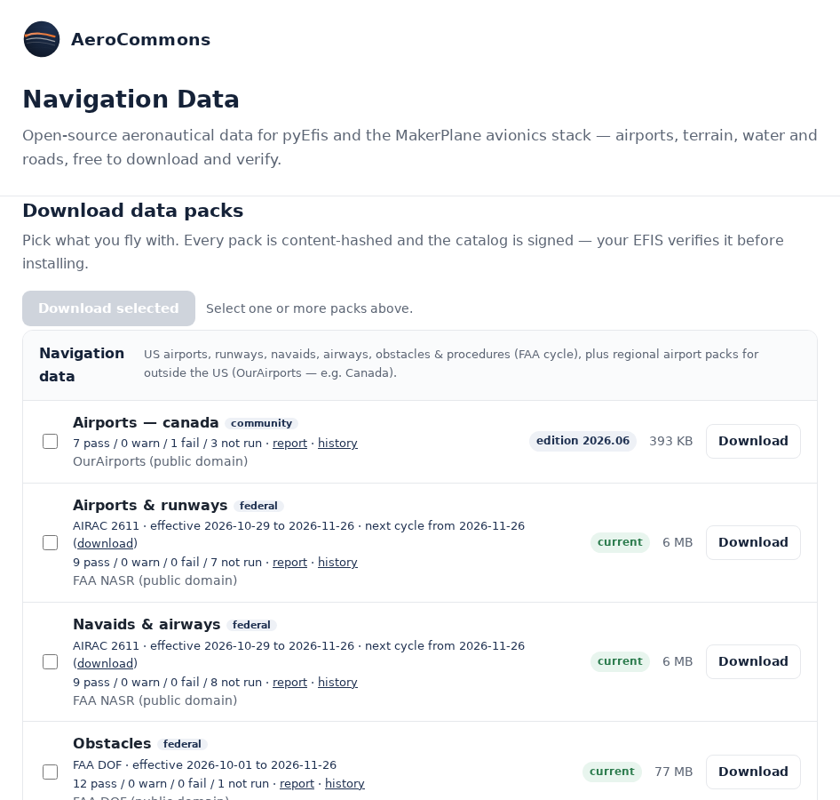
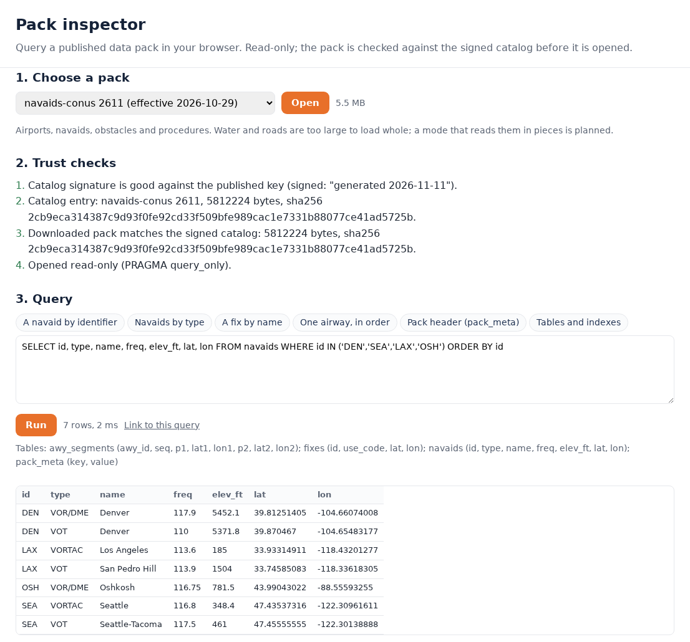
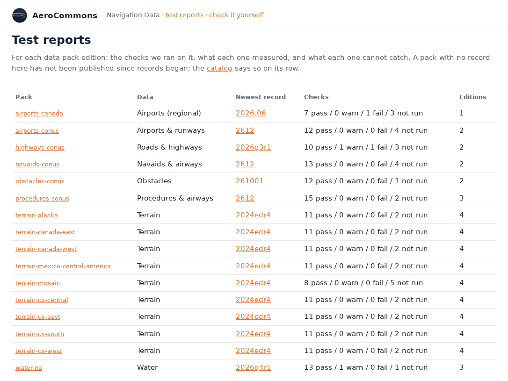
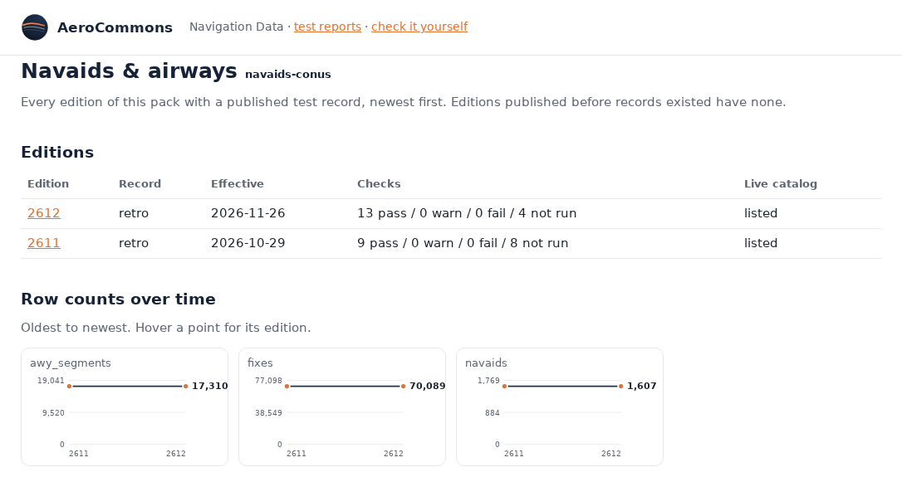
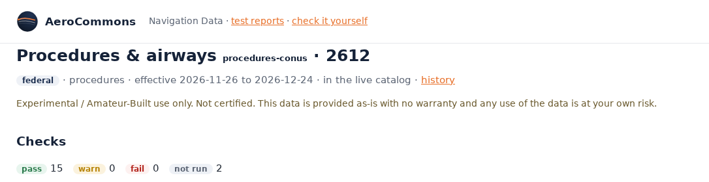
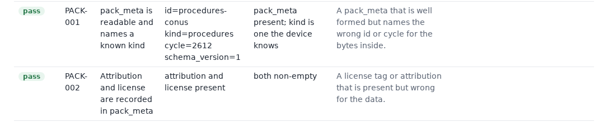
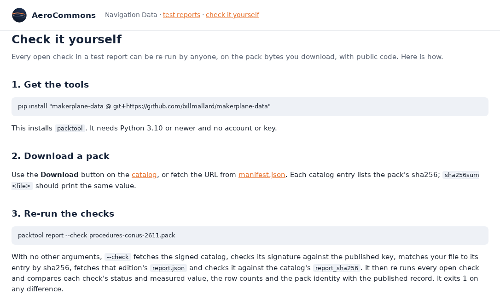
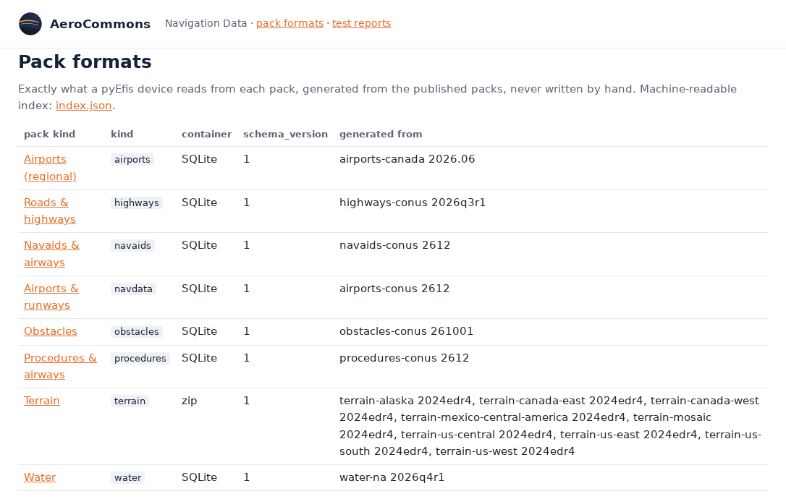

# The navdata Website

[navdata.aerocommons.org](https://navdata.aerocommons.org) is a static site.
It serves the signed catalog, every pack, the test record for every pack, and a
few pages that read them. Nothing on it needs an account. The pages are built
from [`site/`](https://github.com/billmallard/makerplane-data/tree/dev/site)
and from the published records, by `packtool deploy-site`, `packtool
report-site` and `packtool schema-site`; see [[Building and Publishing Packs]].

| Path | What it is |
|---|---|
| `/` | The catalog: every pack, its cycle, currency, test summary and download |
| `/manifest.json`, `/manifest.json.minisig` | The signed catalog and its signature |
| `/packs/<id>-<cycle>.pack` | The packs |
| `/inspect.html` | The pack inspector: query a pack in the browser |
| `/reports/index.html` | Test reports for every pack |
| `/reports/<id>/index.html` | One pack's history across editions |
| `/reports/<id>/<cycle>/report.html` | One edition's test record (`report.json` beside it) |
| `/reports/check.html` | How to re-run the checks yourself |
| `/schema/index.html`, `/schema/<kind>.html` | The format of each pack kind |
| `/advisories.json`, `/advisories.json.minisig` | The signed safety advisory feed |
| `/data.yaml.sample` | A starting `data.yaml` for the device |

## The catalog



The home page reads `manifest.json` and the report index, and lists every pack
in four groups: Navigation data, Terrain, Water and Roads. Each row shows:

- the pack's name and its origin: `federal` for FAA and Copernicus data,
  `community` for OpenStreetMap and OurAirports;
- the cycle and its effective dates, and a link to the next cycle when it is
  already published;
- the test summary (pass, warn, fail, not run), with links to the report and
  the pack's history;
- the attribution, a currency badge (current, expires in N days, expired, or
  the edition), the size, and a **Download** button.

**Download selected** fetches the ticked packs together with `manifest.json`
and `manifest.json.minisig`. Put them all in a folder named `makerplane-data/`
on a USB stick and the device can install from it; see
[[The On-Device Updater]]. The page lists the packs but does not check the
signature itself. The device does, and so does the inspector.

Below the catalog, the page says how to install packs on the EFIS, and lists
every data source and what is done to it.

## The pack inspector



The inspector opens a published pack in your browser and lets you query it with
SQL. It works for the database packs small enough to load whole: airports,
navaids, obstacles and procedures. Water and roads are too large.

Before it opens anything it runs the same checks the device does, and lists
them under **Trust checks**:

1. The catalog's signature is good against the published key, checked with the
   browser's own Ed25519.
2. The pack's catalog entry: id, cycle, size and SHA-256.
3. The downloaded pack matches that size and SHA-256.
4. The pack is opened read-only (`PRAGMA query_only`).

SQLite runs in the page through [sql.js](https://sql.js.org), loaded from a
public CDN and pinned by hash. There are ready-made queries for each kind
(**A navaid by identifier**, **Pack header (pack_meta)**, **Tables and
indexes**, and so on). A query returns at most 1000 rows, and
**Link to this query** gives a URL that reopens the same pack and query.

The URL can also point straight at a place in a pack, which is how the test
reports link to a row they mention:

```
inspect.html?pack=<id>&cycle=<cycle>&sha256=<sha256>&table=<table>&row_id=<n>
inspect.html?pack=<id>&cycle=<cycle>&sha256=<sha256>&table=<table>&lat=<lat>&lon=<lon>
inspect.html?pack=<id>&cycle=<cycle>&sha256=<sha256>&q=<SQL>
```

A `lat`/`lon` locator finds rows within 0.05 degrees (about 3 nm) of the
point, in a table that has `lat` and `lon` columns
([`site/assets/inspect-core.js`](https://github.com/billmallard/makerplane-data/blob/dev/site/assets/inspect-core.js)).

## Test reports



The reports index has one row per pack: its newest record, that record's check
summary, and how many editions have records.

Each pack's history page lists its editions and charts each table's row count
across them, then shows every check's status edition by edition:



An edition's report opens with its origin, dates and whether it is still in
the live catalog, then the check summary:



The check table gives, for every check, what it measured, what it expected, and
what it cannot catch:



When a record was written after its edition was published, the page says so,
and it says when today's publish gate would refuse the edition as a new build.
Those notes come from the record and the current check list; see
[[Pack Reports and Testing]] for what they mean.

## Check it yourself



`/reports/check.html` gives the steps to reproduce a report from the pack bytes
with public code: install `packtool`, download a pack, run `packtool report
--check <file>`, and check the signature with stock `minisign`. Details are on
[[Pack Reports and Testing]].

## Pack formats



`/schema/` documents what a device reads from each kind: its tables, columns and
indexes, or for terrain the file layout inside the zip. The pages are generated
from the published packs after each publish, never written by hand, and
`/schema/index.json` is the machine-readable index. See
[[Pack Format and the Manifest]].
